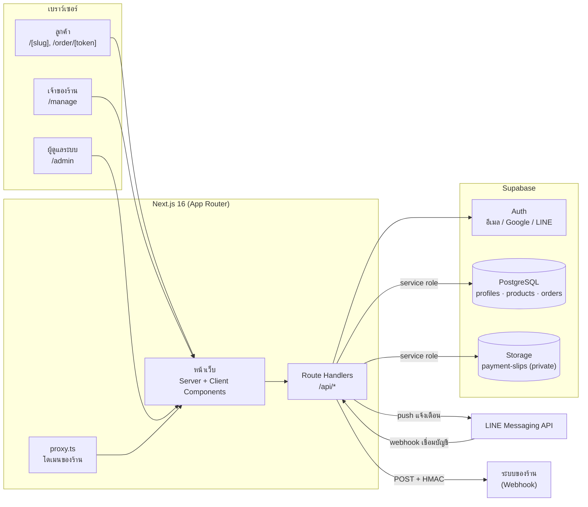
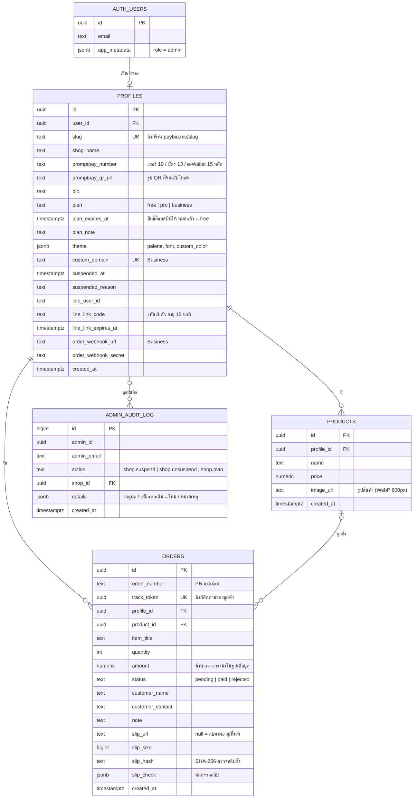
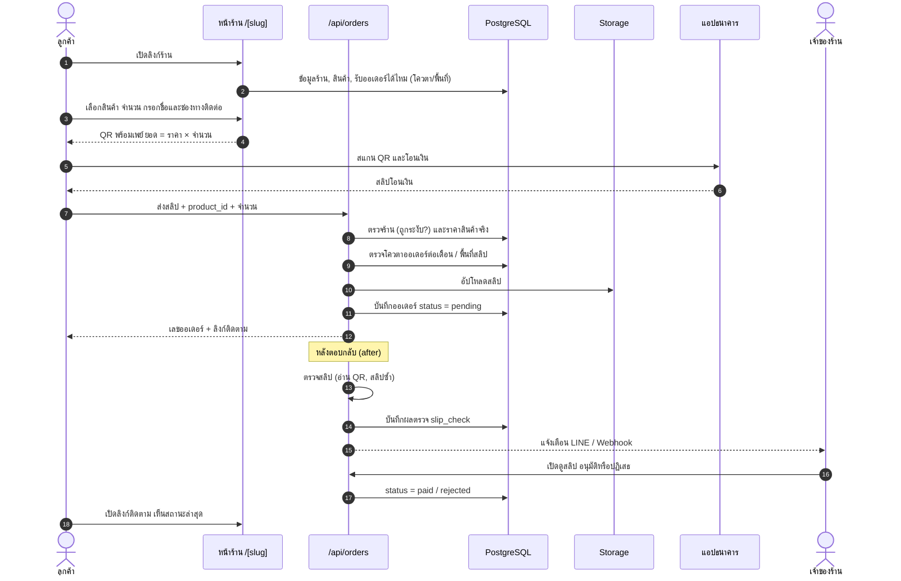
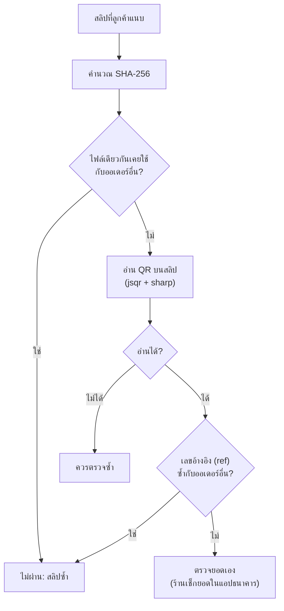

# PayBio — เอกสารออกแบบระบบ

PayBio คือหน้าร้านแบบ link-in-bio สำหรับร้านค้าออนไลน์รายย่อย ลูกค้าเลือกสินค้า สแกน QR พร้อมเพย์ที่คำนวณยอดให้อัตโนมัติ แล้วแนบสลิป ร้านค้าตรวจสอบและอนุมัติออเดอร์ได้จากแผงควบคุม พร้อมรับแจ้งเตือนทาง LINE

เอกสารนี้สรุปจากโค้ดและฐานข้อมูลจริง (ตุลาคม 2569) ไดอะแกรมเขียนด้วย Mermaid แสดงผลได้บน GitHub และ VS Code (ส่วนขยาย Markdown Preview Mermaid Support)

---

## 1. ภาพรวมสถาปัตยกรรม



| ส่วน | เทคโนโลยี | หน้าที่ |
|---|---|---|
| Frontend + Backend | Next.js 16, React 19, Tailwind CSS 4 | หน้าเว็บทั้งหมด และ API (`src/app/api`) |
| ฐานข้อมูล | Supabase PostgreSQL | ร้านค้า สินค้า ออเดอร์ |
| เก็บไฟล์ | Supabase Storage (bucket `payment-slips`, private) | รูปสลิป |
| ยืนยันตัวตน | Supabase Auth | อีเมล, Google, LINE Login |
| QR พร้อมเพย์ | `promptpay-qr`, `qrcode.react` | สร้าง QR ตามยอดเงิน (EMVCo) |
| ตรวจสลิป | `jsqr` + `sharp` (`src/lib/slip-qr.ts`) | อ่าน QR บนสลิปในเครื่อง ไม่มีค่าใช้จ่าย |
| แจ้งเตือน | LINE Messaging API, Webhook (HMAC-SHA256) | แจ้งร้านเมื่อมีออเดอร์ใหม่ |

ทุกการเข้าถึงฐานข้อมูลและไฟล์ทำฝั่งเซิร์ฟเวอร์ด้วย service role ส่วน anon key ในเบราว์เซอร์ใช้แค่ล็อกอิน ตารางทุกตารางเปิด Row Level Security และไม่มี policy ให้ anon จึงอ่านหรือเขียนตรงไม่ได้

---

## 2. ER Diagram



ฟังก์ชันในฐานข้อมูล (เรียกได้เฉพาะ service role)

| ฟังก์ชัน | ใช้ทำอะไร |
|---|---|
| `shop_slip_usage(profile_id)` | รวมขนาดสลิปที่ร้านเก็บอยู่ (ใช้กับโควตาพื้นที่) |
| `admin_order_stats()` | จำนวนออเดอร์ รอตรวจ และยอดที่ชำระแล้วของแต่ละร้าน |
| `admin_daily_stats(days)` | ออเดอร์ ยอดชำระ และร้านสมัครใหม่รายวันตามเวลาไทย (หน้ารายงาน) |
| `admin_suspicious_orders(limit)` | ออเดอร์ที่ผลตรวจไม่ผ่าน/ควรตรวจซ้ำ หรือไฟล์สลิป/เลขอ้างอิงซ้ำข้ามร้าน |

---

## 3. ขั้นตอนการสั่งซื้อและชำระเงิน



---

## 4. การตรวจสลิป



ถ้าตั้งค่า SlipOK (`SLIPOK_API_KEY`, `SLIPOK_BRANCH_ID`) ระบบจะส่งข้อความใน QR ไปตรวจกับข้อมูลธนาคาร (`src/lib/slipok.ts`) ได้ยอดเงิน วันเวลา และผู้รับตามธนาคาร แล้วเทียบยอดกับราคา เทียบผู้รับกับพร้อมเพย์ของร้าน และตรวจเลขอ้างอิงซ้ำทุกแพ็กเกจ ระบบไม่ส่ง `log: true` เพราะใช้บัญชี SlipOK เดียวทั้งระบบ ถ้า SlipOK ใช้ไม่ได้ (ธนาคารขัดข้อง โควตาหมด) จะกลับไปใช้การตรวจด้านล่าง

QR บนสลิปมีรหัสธนาคารผู้โอนกับเลขอ้างอิงรายการ แต่ไม่มียอดเงิน ระบบจึงยืนยันได้ว่าสลิปมาจากธนาคารและไม่ถูกใช้ซ้ำ แต่**ยืนยันไม่ได้ว่าเงินเข้าบัญชีร้านจริง** ร้านต้องเช็กยอดในแอปธนาคารเองก่อนกดอนุมัติ ถ้าตั้งค่า AI ไว้ (`ANTHROPIC_API_KEY`) ระบบจะอ่านยอดเงิน วันที่ และบัญชีผู้รับจากรูปเพิ่มด้วย และจะขึ้น "ผ่าน" ได้ต่อเมื่อยืนยันยอดเงินแล้วเท่านั้น

---

## 5. แพ็กเกจ

ค่าจริงอยู่ที่ `src/lib/plans.ts`

| สิทธิ์ | Free | Pro | Business |
|---|---|---|---|
| สินค้าบนหน้าร้าน | 3 ชิ้น | ไม่จำกัด | ไม่จำกัด |
| ออเดอร์ต่อเดือน (นับตามเวลาไทย) | 50 | ไม่จำกัด | ไม่จำกัด |
| พื้นที่เก็บสลิป | 100 MB, เก็บ 30 วัน | 5 GB ถาวร | 20 GB ถาวร |
| ลายน้ำ "Powered by PayBio" | มี | ไม่มี | ไม่มี |
| ส่งออก CSV | ไม่ได้ | ย้อนหลัง 3 เดือน | ไม่จำกัด |
| แจ้งเตือน LINE | ไม่มี | มี | มี |
| Webhook | ไม่มี | ไม่มี | มี |
| ธีมหน้าร้าน | มาตรฐาน | ชุดสี + ฟอนต์ | + สีแบรนด์เอง |
| โดเมนของร้าน | ไม่ได้ | ไม่ได้ | ได้ |

ผู้ดูแลระบบให้สิทธิ์แพ็กเกจแบบมีกำหนดได้ (7 วัน – 1 ปี หรือไม่หมดอายุ) พร้อมหมายเหตุ เมื่อถึงวันหมดอายุทุกส่วนของระบบจะถือว่าร้านเป็น Free ทันที (`planOf` ใน `src/lib/plans.ts`) และเจ้าของร้านเห็นวันหมดอายุในหน้าตั้งค่าร้าน

เมื่อพื้นที่สลิปเต็ม แพ็กเกจ Free จะลบสลิปเก่าสุดของออเดอร์ที่ร้านตรวจแล้วให้อัตโนมัติ และไม่ลบสลิปที่ยังรอตรวจ ส่วน Pro / Business จะไม่รับสลิปใหม่จนกว่าจะอัปเกรด ทั้งสองกรณีหน้าร้านจะแจ้งลูกค้าก่อนโอนเงิน

---

## 6. หน้าผู้ดูแลระบบ (`/admin`)

| หน้า / แท็บ | ใช้ทำอะไร |
|---|---|
| ภาพรวม | ตัวเลขสรุปทั้งระบบ ออเดอร์และร้านล่าสุด |
| ร้านค้า / ผู้ใช้ / คำสั่งซื้อ | รายการทั้งหมด ค้นหาได้ ระงับหรือยกเลิกระงับร้าน |
| รายละเอียดร้าน `/admin/shops/[id]` | เจ้าของ สินค้า ออเดอร์ล่าสุด พื้นที่สลิป สถานะ LINE/Webhook และ**ให้สิทธิ์แพ็กเกจแบบมีวันหมดอายุ** |
| รายงาน | กราฟออเดอร์ ยอดชำระ และร้านสมัครใหม่รายวัน (7/30/90 วัน) สัดส่วนแพ็กเกจ ร้านยอดขายสูงสุด |
| สลิปน่าสงสัย | สลิปที่ตรวจไม่ผ่าน และสลิปซ้ำทั้งในร้านเดียวกันและข้ามร้าน |
| ประวัติแอดมิน | ใครระงับร้าน / เปลี่ยนแพ็กเกจ เมื่อไหร่ เพราะอะไร |

ทุก API ใต้ `/api/admin/*` ตรวจสิทธิ์ด้วย `requireAdmin()` (`src/lib/admin.ts`) และทุกการเปลี่ยนแปลงบันทึกลง `admin_audit_log`

---

## 7. มาตรการด้านความปลอดภัย

| ความเสี่ยง | วิธีป้องกัน | โค้ด |
|---|---|---|
| ลูกค้าแก้ยอดเงินในเบราว์เซอร์ | คำนวณยอดจากราคาในฐานข้อมูลฝั่งเซิร์ฟเวอร์ | `src/app/api/orders/route.ts` |
| รูปสลิป (ชื่อ/เลขบัญชี) รั่ว | bucket เป็น private ไม่มี policy ให้ anon และเปิดดูได้ผ่านลิงก์ชั่วคราว 5 นาทีหลังตรวจสิทธิ์ | `src/app/api/orders/slip/route.ts` |
| เดาลิงก์ติดตามออเดอร์ | ใช้ UUID แบบสุ่มแยกจากเลขออเดอร์ และไม่แสดงสลิป/ข้อมูลติดต่อ | `src/lib/order-track.ts` |
| ใช้สลิปเดิมซ้ำ | เทียบ SHA-256 ของไฟล์ และเลขอ้างอิงจาก QR | `src/lib/slip-check.ts` |
| เดารหัสเชื่อม LINE | รหัส 8 ตัว (31⁸ แบบ) อายุ 15 นาที เชื่อมเฉพาะรหัสที่ตรงกับร้านเดียว | `src/app/api/line/webhook/route.ts` |
| Webhook ยิงเข้าเครือข่ายภายใน (SSRF) | รับเฉพาะ https และตรวจ IP ตอนเชื่อมต่อจริงทุกครั้ง (กัน DNS rebinding) | `src/lib/order-notify.ts` |
| ปลอม Webhook ของร้าน | ลงลายเซ็น HMAC-SHA256 ใน `X-PayBio-Signature` | `src/lib/order-notify.ts` |
| CSV formula injection | ใส่ `'` นำหน้าข้อความที่ขึ้นต้นด้วย `= + - @` | `src/app/api/orders/export/route.ts` |
| ผู้ใช้ตั้งตัวเองเป็นแอดมิน | ตรวจ `app_metadata.role` ซึ่งแก้ได้เฉพาะ service role | `src/lib/supabase-server.ts` |
| ชื่อร้านชนกับหน้าระบบ | สงวนชื่อ `admin`, `api`, `order`, `pricing` ฯลฯ | `src/app/api/register/route.ts` |

---

## 8. ข้อจำกัดที่ทราบ

- ถ้าไม่ได้ตั้งค่า SlipOK หรือโควตาหมด ระบบยืนยันยอดเงินกับธนาคารไม่ได้ ร้านต้องเช็กเองในแอปธนาคาร (AI อ่านได้แค่ตัวเลขบนรูป)
- SlipOK ตรวจซ้ำ (ปุ่มตรวจสลิปอีกครั้ง) จะใช้โควตาเพิ่มทุกครั้ง
- รายการ "คำสั่งซื้อของคุณ" บนหน้าร้านเก็บไว้ในเบราว์เซอร์ของลูกค้า ถ้าเปลี่ยนเครื่องจะไม่เห็น แต่ค้นหาได้ที่ `/order` ด้วยเลขออเดอร์ + เบอร์/LINE ID/อีเมลที่ใช้สั่ง (จำกัด 10 ครั้ง/10 นาทีต่อ IP ในหน่วยความจำเซิร์ฟเวอร์)
- โควตาออเดอร์ต่อเดือนนับแล้วค่อยบันทึก ถ้ามีออเดอร์เข้าพร้อมกันพอดีตอนเหลือ 1 ออเดอร์ อาจเกินได้ 1–2 ออเดอร์
- ยังไม่มีระบบชำระค่าแพ็กเกจ ผู้ดูแลระบบให้สิทธิ์แพ็กเกจจากหน้ารายละเอียดร้านใน `/admin`

---

## 9. การติดตั้งและฐานข้อมูล

```bash
npm install
npm run dev          # http://localhost:3000
```

ตัวแปรใน `.env.local`

| ตัวแปร | ใช้ทำอะไร |
|---|---|
| `NEXT_PUBLIC_SUPABASE_URL`, `NEXT_PUBLIC_SUPABASE_ANON_KEY` | เชื่อม Supabase (ฝั่งเบราว์เซอร์) |
| `SUPABASE_SERVICE_ROLE_KEY` | เชื่อม Supabase ฝั่งเซิร์ฟเวอร์ (ห้ามเปิดเผย) |
| `SUPABASE_DB_URL` | รัน migration (`scripts/migrate.mjs`) |
| `LINE_CHANNEL_ID`, `LINE_CHANNEL_SECRET` | LINE Login |
| `LINE_MESSAGING_CHANNEL_SECRET`, `LINE_MESSAGING_ACCESS_TOKEN` | LINE OA แจ้งเตือนออเดอร์ |
| `ANTHROPIC_API_KEY` (ไม่บังคับ) | AI อ่านสลิป |
| `SLIPOK_API_KEY`, `SLIPOK_BRANCH_ID` (ไม่บังคับ) | ตรวจสลิปกับข้อมูลธนาคารผ่าน SlipOK |
| `SLIPOK_PLANS` (ไม่บังคับ) | จำกัดแพ็กเกจที่ใช้โควตา SlipOK เช่น `pro,business` (ว่าง = ทุกแพ็กเกจ) |
| `RESEND_API_KEY`, `EMAIL_FROM` (ไม่บังคับ) | อีเมลแจ้งลูกค้าเมื่อสั่งซื้อและเมื่อสถานะเปลี่ยน (Resend) |
| `NEXT_PUBLIC_APP_URL` | ที่อยู่เว็บจริง ใช้สร้างลิงก์ในอีเมลและ LINE (ว่าง = http://localhost:3000) |

รัน migration ตามลำดับวันที่ในชื่อไฟล์

```bash
node --env-file=.env.local scripts/migrate.mjs supabase/migrations/<ไฟล์>.sql
```

| ไฟล์ | เนื้อหา |
|---|---|
| `20261008_shop_suspension.sql` | ระงับร้าน |
| `20261009_plans_and_slip_check.sql` | แพ็กเกจ, โดเมนของร้าน, ผลตรวจสลิป |
| `20261010_order_customer.sql` | ข้อมูลผู้สั่งและจำนวนสินค้า |
| `20261011_order_notifications.sql` | LINE และ Webhook |
| `20261012_shop_theme.sql` | ธีมหน้าร้าน |
| `20261013_slip_storage_quota.sql` | โควตาพื้นที่สลิป |
| `20261014_private_slips.sql` | ปิด bucket สลิปเป็น private |
| `20261015_order_tracking.sql` | ลิงก์ติดตามออเดอร์ |
| `20261016_admin_order_stats.sql` | สถิติสำหรับหน้าแอดมิน |
| `20261017_lock_slip_storage.sql` | ลบ policy ที่เปิดให้ anon เข้าถึงสลิป |
| `20261018_admin_tools.sql` | สิทธิ์แพ็กเกจมีวันหมดอายุ, ประวัติแอดมิน, ฟังก์ชันรายงานและสลิปน่าสงสัย |
| `20261118_shop_promptpay_qr.sql` | รูป QR พร้อมเพย์ที่ร้านอัปโหลดเอง (bucket `shop-assets`) |
| `20261119_order_fulfillment.sql` | ขั้นตอนจัดส่ง เลขพัสดุ ข้อความจากร้าน อีเมลลูกค้า และตาราง `order_events` (ประวัติบนหน้าติดตาม) |
| `20261120_product_images.sql` | รูปสินค้า (`products.image_url`, WebP ใน bucket `shop-assets`) |
